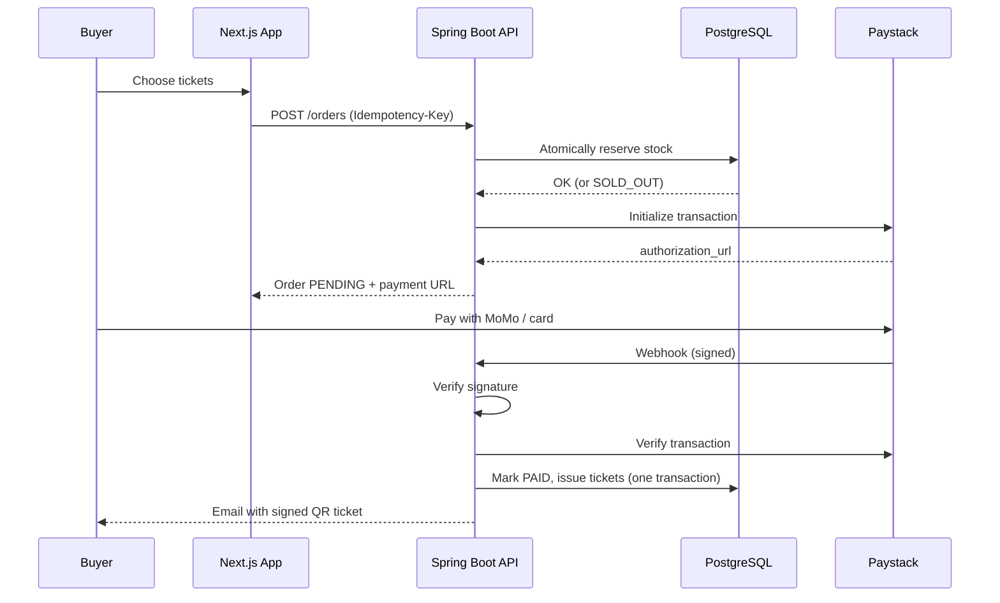
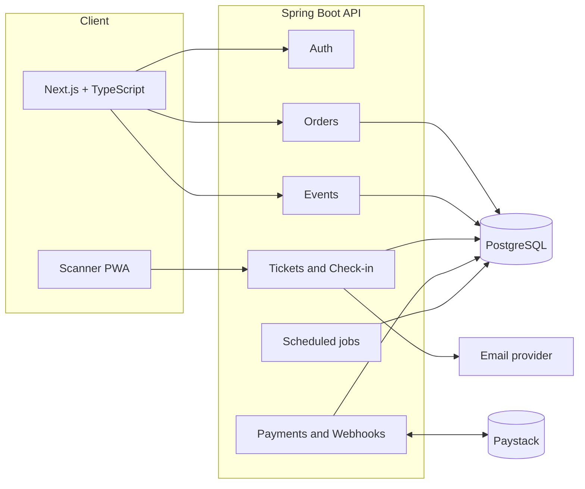
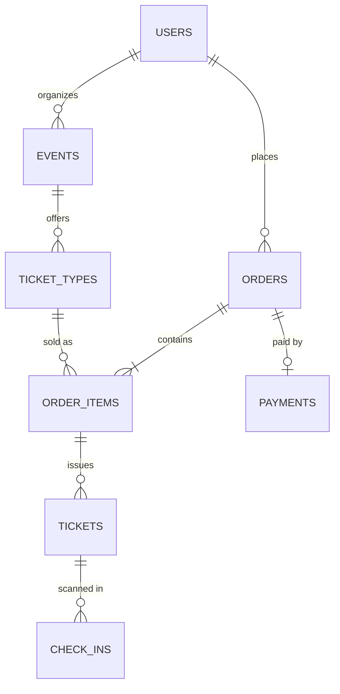

<div align="center">

# 🎟️ TicketPass

### Event ticketing with signed QR tickets and zero overselling

**Sell tickets. Get paid with MoMo or card. Scan at the door. Every ticket works exactly once.**

[**Live Demo**](https://your-demo-url.vercel.app) · [**API Docs**](https://your-api-url.up.railway.app/swagger-ui) · [**Architecture**](#architecture) · [**Hardest Problems**](#the-hardest-problems-and-how-i-solved-them)

[](https://github.com/YOUR_USERNAME/ticketpass/actions)


<!-- Replace with a real screenshot or GIF of the full flow: browse → pay → QR → scan -->


</div>

---

## Why this exists

Many events in Ghana still sell tickets through WhatsApp screenshots and manual Mobile Money confirmations. That creates three real problems:

| Problem | What happens today | What TicketPass does |
|---|---|---|
| **Overselling** | Organizer loses track of what's left | Inventory is enforced by the database in a single atomic statement |
| **Fake or shared tickets** | A screenshot gets forwarded to ten people | Cryptographically signed QR codes, each valid exactly once |
| **No visibility** | No idea how many have paid or arrived | Live sales and attendance dashboard |

---

## Features

**For buyers**
- Browse events and pay with **Mobile Money (MTN, Telecel, AirtelTigo) or card** through Paystack
- Tickets are **reserved for 10 minutes** during checkout, so nobody takes yours mid-payment
- QR ticket delivered by email and available under "My tickets"

**For organizers**
- Create events with multiple ticket types (Regular, VIP, Early Bird), prices, quantities, and sales windows
- Live dashboard: revenue, tickets sold by type, and check-in progress
- Invite door staff to scan tickets

**For door staff**
- Phone-based **PWA scanner**, no app install needed
- Instant result: ✅ valid, ⚠️ already used (with first-scan time), or ❌ invalid
- Live counter, e.g. "248 / 400 checked in"

---

## How it works



---

## The hardest problems, and how I solved them

### 1. Preventing overselling under heavy concurrency

The naive approach (read remaining stock, check it, write the new count) has a race: two buyers can both read "1 left" and both succeed.

TicketPass lets the database make the decision in **one atomic statement**:

```sql
UPDATE ticket_types
   SET quantity_sold = quantity_sold + :qty
 WHERE id = :id
   AND quantity_sold + :qty <= quantity_total
   AND sales_start <= now() AND sales_end >= now();
-- 0 rows affected  →  SoldOutException
```

A `CHECK (quantity_sold <= quantity_total)` constraint acts as a second safety net.

**Proof:** an integration test runs against a real PostgreSQL instance (Testcontainers). With 100 tickets available, **500 concurrent buyers** each try to purchase one. The test asserts exactly 100 orders succeed, 400 fail with `SOLD_OUT`, and `quantity_sold` ends at exactly 100.
See [`OversellIntegrationTest`](backend/src/test/java/com/ticketpass/order/OversellIntegrationTest.java).

### 2. Webhooks that arrive twice, or fake

Payment providers retry webhooks, and a public URL can be hit by anyone. The handler:

1. Verifies the `x-paystack-signature` HMAC against the **raw request body**
2. **Re-verifies** the transaction directly with Paystack before trusting it
3. Is **idempotent**: a unique constraint on the provider reference means the same event processed twice cannot create two payments or two sets of tickets

### 3. Unforgeable, single-use tickets

Each QR encodes a compact payload signed with HMAC-SHA256:

```
tp1.<ticketId>.<eventId>.<HMAC(ticketId|eventId, SERVER_SECRET)>
```

A forged code fails signature verification **before any database lookup**. The payload contains no personal data, so a leaked QR reveals nothing beyond the ticket itself.

At check-in the ticket row is loaded with a pessimistic lock inside a transaction, so two scanners hitting the same ticket at the same instant cannot both succeed. Every attempt, successful or not, is written to a `check_ins` audit table.

### 4. Abandoned checkouts

A scheduled job finds expired `PENDING` orders with `FOR UPDATE SKIP LOCKED` (so overlapping runs never fight over the same rows), marks them `EXPIRED`, and releases the reserved stock.

*Known edge case:* a buyer who pays after their reservation expired. The backend tries to re-reserve; if the event has since sold out, the payment is flagged for manual refund and logged.

---

## Architecture



| Layer | Technology |
|---|---|
| Frontend | Next.js, TypeScript, Tailwind, shadcn/ui |
| Backend | Java 17, Spring Boot 3 (Web, Security, Data JPA, Validation, Scheduling) |
| Database | PostgreSQL with versioned migrations (Flyway) |
| Payments | Paystack (Mobile Money and card) |
| Auth | JWT access tokens with refresh-token rotation, BCrypt |
| Testing | JUnit 5, Mockito, Testcontainers, Playwright |
| CI/CD | GitHub Actions, OWASP Dependency-Check |
| Hosting | Railway (API and database), Vercel (web) |

### Data model



Design choices worth noting:
- **Money is stored as integer pesewas**, never floating point
- Unique indexes on `tickets.code`, `payments.provider_reference`, and `(buyer_id, idempotency_key)` enforce correctness at the database level
- All timestamps are stored in UTC (`timestamptz`)

---

## API overview

Full interactive docs are available at `/swagger-ui`.

| Method | Endpoint | Access | Purpose |
|---|---|---|---|
| POST | `/api/v1/auth/register` · `/login` · `/refresh` | Public | Account and token flow |
| GET | `/api/v1/events` · `/events/{slug}` | Public | Browse and view events |
| POST | `/api/v1/events` | Organizer | Create an event |
| POST | `/api/v1/events/{id}/ticket-types` | Owner | Add a ticket type |
| POST | `/api/v1/orders` | Buyer | Reserve stock, get payment URL |
| POST | `/api/v1/webhooks/paystack` | Paystack | Signed payment events |
| GET | `/api/v1/tickets/mine` | Buyer | My tickets |
| POST | `/api/v1/checkin` | Staff, Organizer | Validate and consume a ticket |
| GET | `/api/v1/events/{id}/attendance` | Staff, Organizer | Checked-in vs sold |
| GET | `/api/v1/events/{id}/sales` | Owner | Revenue and sales by type |

Errors share one shape:

```json
{ "code": "SOLD_OUT", "message": "Only 2 VIP tickets remaining", "timestamp": "2026-11-02T14:03:11Z" }
```

---

## Security

- **Passwords:** BCrypt; credentials and tokens are never logged
- **Auth:** short-lived JWTs (15 min) with rotating refresh tokens
- **Authorization:** ownership checked in the service layer, so an organizer cannot read or modify another organizer's event
- **Webhooks:** HMAC signature verification plus server-side re-verification with Paystack
- **Payments:** card and MoMo details never touch this server; Paystack handles them
- **Abuse protection:** rate limiting on login, order creation, and check-in
- **Validation:** Bean Validation on every request DTO
- **Supply chain:** OWASP Dependency-Check runs in CI on every push
- **Secrets:** environment variables only; `.env.example` is committed, real values never

---

## Testing

```bash
cd backend && ./mvnw verify     # unit + integration tests (needs Docker for Testcontainers)
cd frontend && npx playwright test
```

| Level | Tools | What it proves |
|---|---|---|
| Unit | JUnit 5, Mockito | Pricing math, HMAC signing and verification, status transitions |
| Integration | Testcontainers (real PostgreSQL) | **500-thread oversell test**, order expiry, webhook idempotency, single-use check-in |
| API | MockMvc | Auth rules, ownership checks, error shapes |
| End to end | Playwright | Browse → checkout → ticket, organizer flow |

---

## Run it locally

**Prerequisites:** Java 17+, Node 18+, Docker (for PostgreSQL and tests), a free [Paystack](https://paystack.com) test account.

```bash
git clone https://github.com/YOUR_USERNAME/ticketpass.git
cd ticketpass

# 1. Database
docker compose up -d db

# 2. Backend
cd backend
cp .env.example .env          # add your Paystack TEST secret key
./mvnw spring-boot:run        # http://localhost:8080

# 3. Frontend (new terminal)
cd frontend
cp .env.example .env.local
npm install
npm run dev                   # http://localhost:3000
```

Seed data creates a demo organizer, a sample event, and test ticket types on first run.

### Environment variables

| Variable | Purpose |
|---|---|
| `DATABASE_URL` | PostgreSQL connection string |
| `JWT_SECRET` | Signing key for access tokens |
| `TICKET_HMAC_SECRET` | Signing key for QR payloads |
| `PAYSTACK_SECRET_KEY` | Use a **test** key locally |
| `MAIL_API_KEY` | Email provider key |
| `FRONTEND_URL` | Used for redirects and CORS |

> Use Paystack test keys and test numbers only. Never commit real keys.

---

## Project structure

```
ticketpass/
├── backend/
│   └── src/main/java/com/ticketpass/
│       ├── auth/          # register, login, JWT, refresh rotation
│       ├── event/         # events and ticket types
│       ├── order/         # orders, stock reservation, expiry job
│       ├── payment/       # Paystack client and webhook handler
│       ├── ticket/        # issuance, QR signing, check-in
│       ├── notification/  # email delivery
│       └── common/        # errors, idempotency, config
├── frontend/              # Next.js app and scanner PWA
├── docs/                  # architecture notes, screenshots
└── .github/workflows/     # CI pipeline
```

---

## Scope and trade-offs

I scoped this to a polished, correct core rather than a long feature list.

**Deliberately out of scope for now:** refunds, ticket transfers, promo codes, multi-currency, seat maps.

**Known limitations**
- The scanner needs a connection. Offline scanning with later sync is a good next step, but it reopens the duplicate-scan problem and deserves its own design.
- The expiry job runs inside the API process. On multiple instances it would move to a distributed scheduler; `SKIP LOCKED` already keeps overlapping runs safe.

---

## Roadmap

- [x] Auth with refresh-token rotation
- [x] Events and ticket types
- [x] Atomic stock reservation and oversell test
- [x] Paystack checkout with verified, idempotent webhooks
- [x] Signed QR tickets and single-use check-in
- [x] Organizer dashboard endpoints
- [ ] Refunds and ticket transfers
- [ ] Promo codes
- [ ] Offline-tolerant scanning
- [ ] Caching for public event pages

---

## What I learned

- Correctness belongs in the database. Application-level checks are a convenience; constraints are the guarantee.
- Webhooks should be treated as hints to verify, never as facts.
- A concurrency claim is only worth making if a test can fail when it's wrong.

---

## Author

**Enoch**, software engineer and founder, Accra, Ghana.
[Portfolio](https://enocharmahquaye.tech) · [LinkedIn](https://linkedin.com/in/YOUR_HANDLE) · [GitHub](https://github.com/YOUR_USERNAME)

---

<div align="center">

If this project was useful or interesting, a ⭐ helps others find it.

</div>
